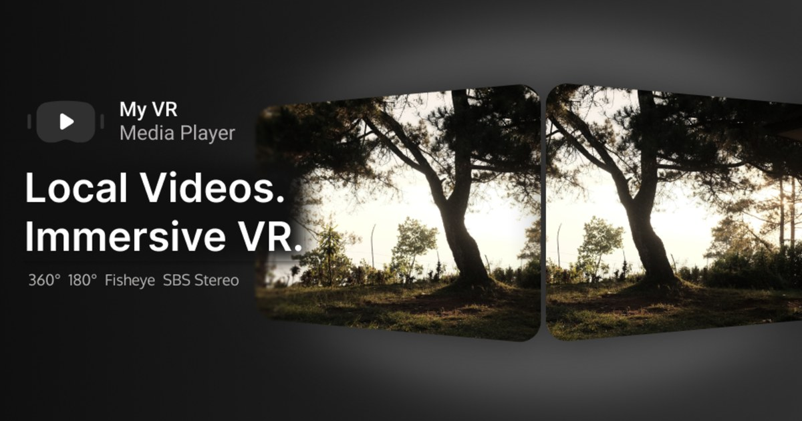

# My VR Media Player — Website

[](https://github.com/solusvoidofficial/MyVRMediaPlayer/actions/workflows/pages.yml)
[](https://solusvoidofficial.github.io/MyVRMediaPlayer/)

Public marketing site for **My VR Media Player** (`com.solusvoid.myvrplayer`) by
**SolusVoid** — an offline-first local VR video player for Android.

**Live site:** https://solusvoidofficial.github.io/MyVRMediaPlayer/

> The Google Play button links straight to the public store listing:
> https://play.google.com/store/apps/details?id=com.solusvoid.myvrplayer



## What's inside

- Product home page with feature highlights, ad/premium disclosure and a screenshot gallery
- Privacy Policy — the canonical URL submitted to Google Play
- Terms of Use — linked from the app's Legal section
- Open-source licenses and attribution
- Custom 404, `robots.txt`, `sitemap.xml`, social preview image and favicons

The site is **static HTML + CSS** with no build step, no framework, no cookies and no
analytics. It adapts to light/dark system themes, works down to 320 px, ships a
`site.webmanifest`, and honors `prefers-reduced-motion`.

## Structure

| Public URL | File |
|---|---|
| `/` | `index.html` — home + screenshots |
| `/privacy/` | `privacy/index.html` — canonical privacy policy |
| `/privacy.html` | `privacy.html` — redirect alias |
| `/terms/` | `terms/index.html` — Terms of Use |
| `/licenses/` | `licenses/index.html` — open-source attribution |
| `/404.html` | `404.html` — self-contained error page |
| `/sitemap.xml`, `/robots.txt` | search engine metadata |
| `/assets/img/` | optimized WebP/JPEG screenshots, OG cover, icons |

## Local preview

```powershell
python -m http.server 8080
# open http://localhost:8080/
```

Or run it over HTTP as shown above; opening `index.html` via `file://` will not resolve
directory URLs such as `privacy/`. All local links are relative, so the site also works
from a subdirectory.

## Deployment

Every push to `main` deploys through
[`.github/workflows/pages.yml`](.github/workflows/pages.yml) using the official
`deploy-pages` action (artifact path `.`).

One-time repo setting: **Settings → Pages → Build and deployment → Source: GitHub Actions**.

- `.nojekyll` must stay so GitHub Pages serves the files as-is.
- `404.html` is self-contained (inline CSS, absolute URLs) because Pages serves it for
  paths at any depth. Update its URLs if the site ever moves to a custom domain.
- All other pages use relative URLs; moving to a custom domain needs no HTML edits.

## Content rules

Run `python tools/check_site.py` after edits: it verifies local links and fragments,
forbidden private references, and the required copy below.

Keep public claims aligned with the app's PRD and Play listing:

- **MediaPlayer** is the default engine; **Media3 ExoPlayer** is opt-in in Settings.
  Both rely on device codecs. MP4/MOV/3GP with H.264 are the supported playback targets;
  subtitles are not supported.
- No banner, native or rewarded ad appears during playback or in the VR view. Ads are
  limited to Browser/Settings, with consent handled by Google UMP.
- Remove Ads is a one-time purchase; it disables ads and the app's resolution limit but
  cannot guarantee decoding of every format or resolution.
- The Play CTA must link to the live public store listing (currently
  https://play.google.com/store/apps/details?id=com.solusvoid.myvrplayer). Never point it
  at a closed test, private, or dead URL; a dead Play link reads as a quality problem
  during AdMob review.
- The Privacy Policy must stay in sync with the Play Console **Data safety** form.
  `privacy/index.html` is the canonical URL.
- Privacy copy must stay in sync with the **limited-ads** policy and **US-state**/GDPR
  rights behavior: declining personalization or opting out is **not** zero ads, limited
  or non-personalized ads may still appear when UMP/TCF/GPP and Google policy allow, and
  only Remove Ads removes ads. The EEA/UK/CH form can appear at launch and from Settings;
  the US-state form is reached via **Settings → Legal → Privacy options**. Keep the
  controller/contact and international-transfer sections current.
- The Licenses page must stay self-contained. Do **not** reference files or source paths
  from the private app repository (for example `THIRD_PARTY_NOTICES.md`, `LICENSE`, or
  `ui/...`). List components and link only to public upstream license pages.
  `tools/check_site.py` enforces this ban on every HTML page, not just Licenses.

## Assets

Marketing screenshots are derived from the supplied app captures and optimized to
WebP/JPEG (all site images together are under 350 KB). When replacing an image, update
its `width`/`height` attributes in the HTML to match. The social preview is
`assets/img/og-cover.jpg` (1200×630), referenced with absolute URLs on every page.

## `app-ads.txt`

`app-ads.txt` is **not** served from this project page — AdMob looks for it at the host
root. It lives in the user-site repo
[`solusvoidofficial/solusvoidofficial.github.io`](https://github.com/solusvoidofficial/solusvoidofficial.github.io)
and is available at https://solusvoidofficial.github.io/app-ads.txt.

## Contact

Developer: **SolusVoid** — solusvoidofficial@gmail.com

Found a broken link or outdated information? Open an issue or email us.

---

© 2026 SolusVoid. Site content, screenshots and artwork are all rights reserved.
